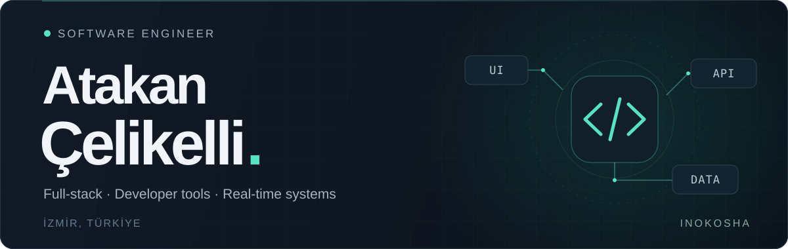

  

  <a href="https://celikelli.com.tr">Portfolyo ↗</a>
  &nbsp; · &nbsp;
  <a href="https://inokosha.com.tr">Inokosha ↗</a>
  &nbsp; · &nbsp;
  <a href="https://github.com/Keskinpala?tab=repositories">Projeler ↗</a>

## Selam, ben Atakan 👋

İzmir'de yaşayan bir **yazılım mühendisiyim**. Web uygulamaları, gerçek zamanlı sistemler ve geliştiricilerin günlük işini kolaylaştıran araçlar geliştiriyorum.

**Inokosha** çatısı altında fikirleri çalışan yazılımlara dönüştürüyorum. Backend'den arayüze kadar ürünün tamamıyla ilgilenmeyi; süreçleri sadeleştirmeyi ve tekrar eden işleri otomatikleştirmeyi seviyorum.

### Çalıştığım teknolojiler

  
  
  
  
  
  
  

### Seçili çalışmalar

#### [01 — Z.ai Monitor](https://github.com/Keskinpala/z_ai_quota_displayer)

Z.ai API kota ve token kullanımını masaüstünden takip etmek için geliştirdiğim araç. Her zaman üstte duran pencere, sistem tepsisi, kota bildirimleri ve çoklu dil desteği.

`Python` `Tkinter` `Windows` · [Kodu incele ↗](https://github.com/Keskinpala/z_ai_quota_displayer)

#### [02 — WebSocket API](https://github.com/Keskinpala/InokoshaYazilim_WebSocketApiApp)

Uygulamalar arasında gerçek zamanlı iletişim için API anahtarıyla çalışan WebSocket sunucusu. Mesajlaşma ve MySQL üzerinde veri saklama.

`Node.js` `WebSocket` `MySQL` · [Kodu incele ↗](https://github.com/Keskinpala/InokoshaYazilim_WebSocketApiApp)

#### [03 — Kişisel portfolyo](https://celikelli.com.tr)

Nuxt ve Vue ile hazırladığım kişisel web sitem. Three.js ve GSAP ile etkileşimli bir arayüz.

`Nuxt` `Vue` `Three.js` `GSAP` · [Siteyi gez ↗](https://celikelli.com.tr)

---

<strong>A little about me, in English</strong>

I'm Atakan, a software engineer based in İzmir, Türkiye. I build full-stack web applications, real-time systems, and developer tools at Inokosha.

My public projects include a desktop monitor for Z.ai API usage and a WebSocket server with API-key access and MySQL persistence. I enjoy simplifying workflows and turning ideas into useful software.

  Bir fikir, bir proje veya teknik bir sohbet için: <a href="https://celikelli.com.tr">celikelli.com.tr</a>

